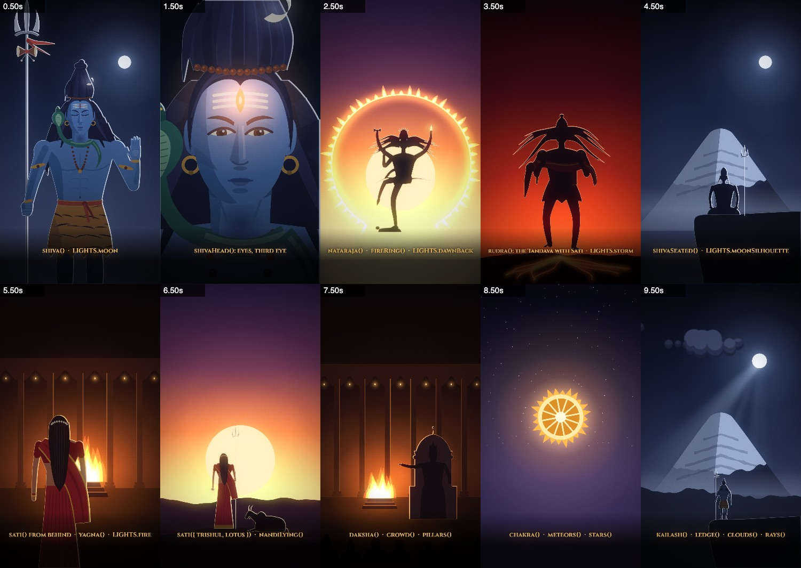
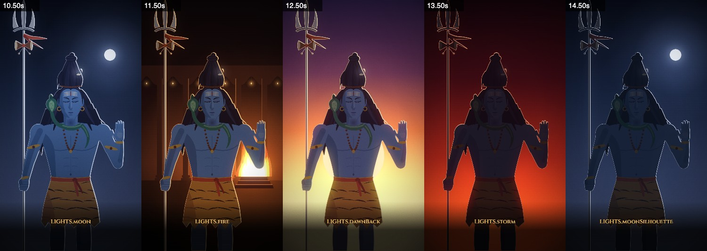

# The Cinematic style

Read this before making a reel in the **Cinematic** style (see [STYLES.md](STYLES.md)). It's a "cinematic motion
comic": flat vector figures with semi-realistic proportions, lit like a film. The lighting, the camera and the
captions do most of the work, and the figures barely move.

The model for it was an Instagram story reel (Eklavya and Drona, ~53 s, flat vector, dusk and night palettes, small-caps
serif captions that light up with the voice). The first reel built in it is `reel/shiva-cinematic`, "There is one dance
even the gods fear" (Shiva's Tandava, Sati, the Shakti Peethas, Shailputri; 62 s). The owner called it brilliant: start
a new one by reading that branch's `STORYBOARD.md` and `src/scenes/shiva_cine.js`.

**Use it for** epic, devotional and dramatic stories, explainers with a turn ("known yet unknown"), anything that
should feel grand. **Use Painted** ([ANIMATION_GUIDE.md](ANIMATION_GUIDE.md)) for slapstick, chibi comedy and the kid
series.




---

## The look: what makes it

| ingredient | how | where |
|---|---|---|
| Flat shapes, no outlines | bezier `Path2D` fills; 2–3 tones per surface (base, shade, a highlight); shading clipped inside the shape | `fillPath`, `inside`, `limb` |
| A thin light line round every figure | `figure(c, draw, { edge })`: an 8-way erosion of the figure's alpha, filled with light | `figure` |
| Rim light on the side facing the light | `figure(..., { rim: { dx, dy } })`: the alpha minus itself shifted toward the light | `figure`, `LIGHTS` |
| A colour cast and falloff | `tint` (a flat cast, up to near-black for a silhouette) and `grade` (darker toward the feet) | `figure` |
| Skies by mood | vertical gradients: night blue, storm red, dawn gold, fire-lit hall | `sky` |
| Depth | 4–8 layers on planes: sky (0), far peaks (.25), haze bands between, ridges (.5), the stage (1), foreground and particles (1.2+) | `plane`, `ridge`, `haze` |
| Atmosphere | drifting clouds with lit tops, god rays, dust, snow or embers, a glow round every light | `clouds`, `rays`, `motes`, `glow` |
| Film finish | bloom on the brights, a heavy vignette, animated grain (all automatic, `LOOK`) | `frame` |
| A slow camera | push in or pull out on every shot (ease in/out, ~5–15% zoom); shakes only on impacts | `plane(c, cam, …)` |
| Transitions | crossfades (`xf`) between shots; white or gold flashes on big beats (`POST`) | `SHOTS`, `flash` |
| Karaoke captions | Cinzel small caps, centred; each word goes from dim to lit in reading order, names in gold | `say` |

Colour is mood. Give each beat its own palette and change it when the story turns: cold blue for calm and grief, red
for rage, warm orange for fire and court, gold for joy and grace, deep violet for the sacred at night.

## Files

| file | what it is |
|---|---|
| [src/cine.js](src/cine.js) | the engine: math, layers, `figure()` and `LIGHTS`, camera planes, skies, clouds, haze, rays, motes, lightning, flashes, karaoke captions, pictures and text, the frame (bloom, vignette, grain), and the page hooks `render.mjs` uses |
| [src/cine_shiva.js](src/cine_shiva.js) | Shiva in colour (front view, trishul and damru, abhaya, snake, mala, jata with the moon; eyes and third eye open), his head for close-ups, and the Nataraja silhouette |
| [src/cine_cast.js](src/cine_cast.js) | Sati (from behind; with `trishul` and `lotus` she is Shailputri), Daksha on his throne, crowds, the Rudra Tandava (Shiva carrying Sati), Shiva seated, Nandi lying, the Sudarshan chakra, the yagna fire |
| [src/cine_sets.js](src/cine_sets.js) | scenery: `PALETTES`, Kailash, a cliff, cloud banks, the ring of fire, a fire-lit hall with pillars, embers, ground cracks, meteors, stars, shrines, and `rkCardCine()`, the end card |
| [cine.html](cine.html) | the style's studio page; on `main` it shows [src/scenes/cine_sheet.js](src/scenes/cine_sheet.js), the cast and lighting sheet |
| [tools/sfx.mjs](tools/sfx.mjs) | the synth; its "epic and devotional" section (thunder, damru, wind, drum, fire, om, conch, laughter, heart, whir, chime, chirp) is this style's sound kit |

`node render.mjs --page=cine.html --sheet=…` renders the sheet. The engine renders about 30 ms a frame (a 62 s reel
takes under a minute).

## Start a reel in this style

1. Branch off `main` as usual (`reel/<idea>` or `ad/<n>-<book>-<idea>`).
2. `cp cine.html studio.html`; in the copy, replace the inline `PROJECT` script with `<script src="src/config.js">` and
   the scene script with yours. Set `src/config.js`: `{ duration, w: 1080, h: 1920, fonts: [...], audio }` (keep the
   card fonts if the reel ends on `rkCardCine`).
3. Write `STORYBOARD.md`: the beats, a caption for each (see Captions), a palette for each, then the shot list.
4. Write `src/scenes/<name>.js`: a `TL` object of named times, then one `SHOTS.push({ a, b, xf, draw(c, u, t) })`
   per shot, `POST` flashes, and the `say(...)` captions. `u` is time since the shot began, `t` the reel's time.
5. Write `tools/<name>_sfx.mjs` with the same `TL` (copy the reel's), and render `assets/<name>_sfx.wav`.
6. Check with sheets and crops as you go (see Checking), then `node render.mjs --clip --out=out/<name>_sfx.mp4` and the
   `--audio=none` copy.

A shot, in full:

```js
SHOTS.push({ a: 3.9, b: 8.4, xf: .5, draw(c, u, t) {
  const cam = { z: lerp(1.0, 1.14, easeIO(u / 4.5)), fx: 540, fy: 790 }, fl = strikes(t, [6.35]);
  plane(c, cam, 0, (c) => sky(c, [[0, '#070B17'], [700, '#152039'], [1400, '#2F3B5B'], [1900, '#3E4A68']]));
  plane(c, cam, .05, (c) => { glow(c, 840, 420, 520, '#7F97CC', .42); ellipse(c, 840, 420, 44, 44, '#E6ECF6'); });
  plane(c, cam, .1, (c) => clouds(c, [[0, 260, 820, 11, 30], [500, 520, 700, 12, 40, true]], t, PALETTES.nightFar, .9));
  plane(c, cam, .15, (c) => { bolt(c, 980, -40, 760, 1250, 21, fl); flash(c, fl * .3, '#9FB6F0'); });
  plane(c, cam, .25, (c) => { kailash(c, 240, 1120, 420); haze(c, 1500, 360, '#6E7C9E', .55); });
  plane(c, cam, 1, (c) => figure(c, (f) => { f.translate(540, 2210); f.scale(1.75, 1.75); shiva(f, { t, eyes: 0, arm: 'abhaya' }); },
    { ...LIGHTS.moon, rim: { ...LIGHTS.moon.rim, a: .8 + fl * 1.2 } }));
  plane(c, cam, 1.2, (c) => motes(c, { n: 60, seed: 9, box: [-100, 0, W + 100, 1950], r: 3.5, col: '#DCE6FF', a: .5, vx: 120, vy: 140, t }));
} });
```

## The engine

**Frame.** `frame(c, t)` draws every shot live at `t` (the last fully faded-in one and any fading in over it), then
`POST`, then bloom (`LOOK.bloom`), the vignette (`LOOK.vignette`), grain (`LOOK.grain`), and the captions on top.
Everything is a pure function of `t`; nothing is kept between frames.

**Shots.** `SHOTS.push({ a, b, xf, draw(c, u, t) })`. Overlap a shot with the one before by `xf` seconds and it
crossfades in over them. For a flash cut, overlap by a little and put a `flash()` in `POST` that peaks at the cut.

**Camera.** `plane(c, cam, depth, draw)`: `cam = { z, x, y, r, fx, fy }` zooms (about the focus `fx, fy`), pans and
rolls the stage (depth 1). Depth 0 never moves (the sky); between 0 and 1 moves less (far mountains); above 1 moves more
(foreground, particles). Coordinates are screen pixels at the camera's rest. For a shake, add `Math.sin(t * 53) * k` to
`cam.x` and `Math.cos(t * 41) * k` to `cam.y`.

**Lighting a figure.** `figure(c, draw, o)` draws `draw` into its own layer and lights it:
`tint: [col, a]`, `grade: [[y0, col0], [y1, col1]]`, `edge: { col, w, a }`, `rim: { col, dx, dy, a, blur }`, `alpha`.
Use `LIGHTS.moon | moonSilhouette | fire | dawnBack | storm` (in [src/cine.js](src/cine.js), each with a note on
when), and spread one to change a part. Rim `dx/dy` are screen pixels: ~6 for a figure 1500 px tall, 3 for a small
one, 9 for a full-frame face. Nest `figure()` for parts that overlap (an arm over the chest) so each gets its own edge:
`shiva()` takes `armFx` for that.

**Drawing.** `fillPath(c, svgPath, col)` (the main tool: author shapes as SVG path strings), `strokePath`, `ellipse`,
`poly`, `limb(c, points, widths, col)` (a tapered tube through points: arms, legs, locks, snakes, sashes, flames),
`inside(c, clipPath, fn)` (shade inside a shape), `through` (a smooth curve). `mirrorX(path)` flips a path string.

**Set.** `sky(c, stops)`, `glow(c, x, y, r, col, a)` (additive light), `cloud(...)`/`clouds(...)` (cached sprites),
`ridge(c, y, amp, seed, col)`, `haze(c, y, h, col, a)`, `rays(c, x, y, o)` (god rays), `motes(c, o)` (dust, snow,
embers: `vx, vy` px/s), `bolt(...)` + `strikes(t, times)` (lightning with a double flicker), `flash(c, a, col, op)`,
`soft(c, k, draw, o)` (draw at 1/k size and lay it back: free softness for glows and haze), `sprite(key, w, h, draw)`.

**Captions.** `say(a, b, text, { y, size, at })`: on screen from `a` to `b`, fading in and out inside that window.
`*Name*` lands in gold; a lone `|` breaks the line. Without `at`, words light in reading order across the window (the
viewer's reading guide when there's no voice); with a voice track, pass each word's start time in `at`. Style in `CAP`.

**Pictures and text** (cards): `picture(c, img, x, y, w, h, { pop, rot, r, shadow, glow })` and
`text(c, txt, x, y, font, col, { pop, glow, maxW, spacing })`; `pop` is seconds since it appeared (it springs in).
`PICS` comes from `src/scenes/rk_images.js`.

## Building a character for this style

- **Units.** Feet at (0, 0), up is −y, an adult is ~820–1000 tall (Shiva's jata top is −1004). Place and scale with the
  canvas transform. Draw the head in the same units, so a close-up is the same drawing ×6–7 (`translate` to where the
  face goes, `scale(k)`, `translate(0, 815)`).
- **Proportions.** Semi-realistic and heroic: the head about 1/7.5 of the height, broad shoulders, a narrow waist,
  long tapered limbs, simple mitten hands. A face is about 0.72 as wide as it is tall, the jaw angled, the chin narrow.
- **Order.** Back to front: back hair, props behind the hand, legs, the lower garment, torso, head (neck first), then
  jewellery, the snake and the arms (each arm its own `figure()` for its edge).
- **Shading.** One flat base per surface, then the shade shape clipped `inside()` it, on the side away from the light.
  Write shade shapes for light from the right and flip them with `c.scale(L, 1)` for `light: -1`. Add one soft
  highlight (the bridge of the nose) and the cast shadows that sell form: under the jaw on the neck, under the nose and
  the lower lip, the lid on the eye.
- **Faces.** The upper lid line is the strongest line; eyes take an `eyes` 0..1 open amount (closed = a downward arc
  with lashes). Keep the shading quiet: the edge and rim lights do the modelling.
- **Silhouettes.** Far figures, dancers and anything hard to draw in colour read best as a near-black shape with a lit
  edge (`LIGHTS.moonSilhouette`, `storm`, `dawnBack`). Give them clear negative space (arms off the body, legs apart)
  and a recognisable outline (jata, trishul, crown, horns).
- **Two figures as one** (a figure carried): keep the carried one in its colours over the dark carrier, or the shapes
  merge into a creature. `rudra()` draws Shiva black and Sati in her red sari.
- **Motion budget.** Little: breathing (±1–2 units), hair and sashes in the wind (`wind`, `gust`), a nodding hood, eyes
  opening, a walk as a slide with a small bob and a scale change, a stamp cycle. The camera and the light do the rest.

## Lighting recipes

| moment | sky | figure | extras |
|---|---|---|---|
| Night, calm or grief | `#060A15 → #47516E`, a moon with a big soft `glow` | `LIGHTS.moon` (colour) or `moonSilhouette` (far) | god rays from the moon, snow motes, haze bands |
| Storm, rage | `#12040A → #D0461E` red | `LIGHTS.storm` silhouette | `bolt` + `strikes` (add the flicker to `rim.a`), `cracks`, `meteors`, embers rising, shake on impacts |
| Fire, court, sacrifice | `hallSky`, `pillars` lit on the fire's side | `LIGHTS.fire`, the fire beyond the figure | a big `glow` round the fire, `embers` |
| Dawn, joy, grace | `#24183A → #FFE2A8`, a huge pale sun | `LIGHTS.dawnBack` | radial `rays` from the sun, gold motes rising, `fireRing` for Nataraja |
| A power awakening | dark | a coloured glow on the face (`glow` at the third eye, growing) | an orange `flash` flicker, a small shake, push in, white-out |

## Shots that work

- **The establishing wide.** A small silhouette on a ledge against a big landmark (Kailash), the moon and its rays,
  clouds drifting, snow; a slow push toward the figure. Frame 0 of the reel: the hook caption is already up.
- **The hero push-in.** The character knees-up, the camera pushing ~14% toward the face over 4 s; lightning behind.
- **The face.** The head ×6.6 filling the frame, eyes closed; they snap open (0.2 s), then the power wakes; push in
  hard and white-out into the next beat.
- **From behind.** A figure facing a fire or a sunrise reads instantly and needs no face (Sati, Shailputri).
- **The walk into.** Slide the figure toward the thing on its plane (same depth as the target, or parallax slides it
  past), scale down, a small bob, fade as the target's flames close over it; flash.
- **The silhouette dance** against a disc of light or a ring of fire, the camera pulling back from 1.2× to 1.
- **The landscape of lights.** Layered night hills; embers fall and each lights a shrine (51 Shakti Peethas).
- **Time passing.** The moon arcs across the sky in 3 s over a figure that doesn't move; snow thickens.
- **The card.** `rkCardCine()` on dark teal and gold, held without a fade.

Pace: 3–6 s a shot, one beat per shot, every shot moving (a push or a drift at least).

## Captions (no voice)

- **2.2–3 s per caption** (3 s for the comment ask), split into 3–7 word chunks. Two chunks to a shot is typical.
- **Place them** in the shot's empty space, inside y 420–1500: above the subject on wide shots, under the chin on a
  face, over the chest on a medium shot (the dark glow behind the letters keeps them readable). 56 px, 62–72 px for
  a short line that should hit.
- **Names in gold** (`*Shiva*`); the big name of the reel can have its own line and size.
- **Frame 0**: start the first chunk at −0.35 s so its first words are lit.
- **The comment ask** gets its own lines with `|` breaks: `'Is there a *Shakti* *Peeth* | near YOU? | Comment your city!'`.

## Sound

No voice or music by default (the owner may add music in Instagram; always render the `--audio=none` copy too). The
sound is the score. Build it from the shared kit in `tools/sfx.mjs`:
- a bed per beat: `wind` (two copies panned), an `om` drone for the sacred, `fire` for fire scenes;
- events on the frame: `thunder` on `strikes` times, `drum` booms on stamps and impacts, a `damru` roll on "Tandava",
  `whir` + a metallic `bell` for a chakra, `conch` on a goddess's name, `chime`s for lights appearing (pentatonic),
  `heart` under a tense walk, `laughter` for a mocking crowd, `chirp`s at dawn;
- an arc: quiet hook, building, the loudest beat at the climax, calmer after, a soft chime and drone on the card.
Check the levels without listening: print the loudness per 2 s and look for the arc (and for silence, which means one
sound blew up and crushed the normalisation: a filter cutoff below 0 does that).

```sh
node -e "const b=require('fs').readFileSync('assets/<name>_sfx.wav'),d=b.subarray(44),n=d.length/4,sr=48000,o=[];
for(let s=0;s*sr<n;s+=2){let q=0;for(let i=s*sr;i<Math.min(n,(s+2)*sr);i++){const v=d.readInt16LE(i*4)/32768;q+=v*v}o.push(s+':'+(10*Math.log10(q/2/sr)).toFixed(0))}console.log(o.join(' '))"
```

## Checking your work

- `node render.mjs --sheet=…` at each caption and shot change; `--crop=x,y,w,h` for faces and hands; `--strip=a:b` for
  a walk or a transition, frame by frame.
- Before the final render, a QA sheet of the whole reel every ~2 s: captions never overlap, every shot moves, every
  flash lands on its beat, the card holds.
- `--stills=0` for the thumbnail.

## Lessons from the first reel

- The first face was too wide and its shade cut across the mouth: keep the shade strip on the far cheek, ending before
  the mouth corner.
- Hair as one polygon reads as a hood; build it from several locks. A jata of stacked rings reads as a hat: draw
  locks gathered up into a knot.
- A silhouette carrying a silhouette becomes a creature: keep one in colour.
- Locks fanning upward look like antennae: send them out and down.
- A figure walking toward a fire must sit on the fire's plane, or the camera slides it past the altar.
- Captions that fade outside their window overlap the next one during crossfades: fade inside `[a, b]` (the engine
  does).
- The Nataraja follows the texts (the left leg raised and swung across, the lower left hand pointing to it); confirm the
  orientation against a bronze before the next close look at it.
