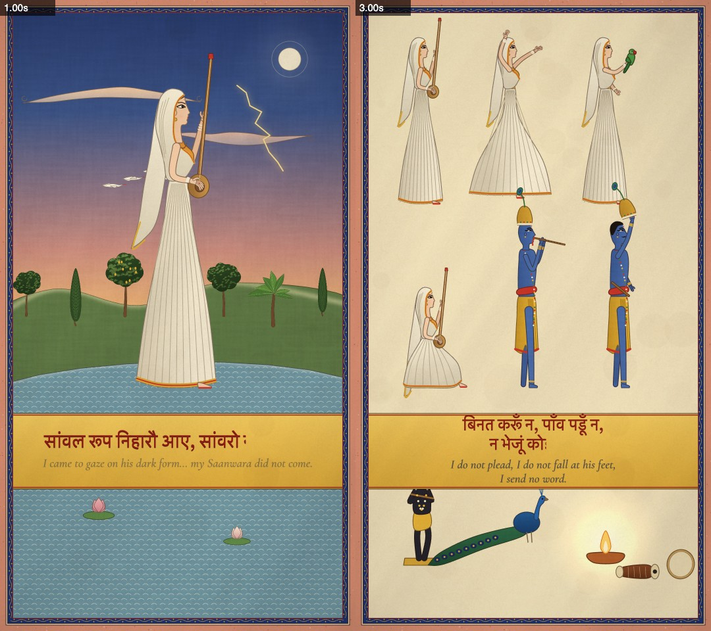

# The Miniature style

A Pahari (Kangra) miniature painting made in code, on cine.js. Flat opaque pigments (lapis, Indian yellow, vermilion,
malachite, white lead) inside a fine sepia line; faces in profile with one straight brow-and-nose line and a long
fish-shaped eye with kajal; slender figures in cloth with fine fold lines and gold borders; trees built leaf by leaf;
water as rows of little curls; streaky cloud bands and gold lightning; white pavilions with cusped arches. The painting
sits in a folio (a speckled salmon margin, black-white rules, a lapis band with a gold vine) on wasli paper, and the verse
is written on a yellow inscription band, Devanagari in red with its English meaning in indigo italic under it.
The camera moves slowly over each painting; only small things move (eyes, a lamp, water, birds, cloth, a dance).

**Use it for** sung poems and bhajans, bhakti (Mira, Surdas, Kabir), viraha and love (Radha–Krishna), the seasons
(baramasa), anything that should feel like an old folio. Built for a follower's poem, Oct–Nov 2026: first reel
`reel/mira-saanwaro` ("Saanwaro nahi aayo", Shivangi Singh). Flat colour with no painted texture, so it should be
safe from Instagram's AI label (see the IG note in PAINTERLY_GUIDE.md). Never call the art hand-painted in viewer copy.

## Files
| file | what |
|---|---|
| `src/miniature.js` | the style over `src/cine.js` (load after it): `mnPath`/`mnFill`/`mnStroke`/`mnLimb` (flat pigment with its fine line, `shade` for a soft wash), `mnLook` (a camera that centres a stage point), skies (`mnSky` dusk/night/day/dawn/storm, `to`+`k` to blend), `mnCloudBand`, `mnLightning`, `mnStars`, `mnMoon`, `mnHill`, `mnTree` (dome, cypress, plantain, blossom, mango, bare; `season` spring/monsoon/autumn/winter; cached sprites), `mnWater` (the curl pattern, `flow`), `mnLotus`, `mnArchPath` (a cusped arch), `mnRail`, `mnDome`, `mnCrane`; the folio, paper, gouache mottle and the verse band in `LOOK.finish` |
| `src/mn_cast.js` | `mnMira` (Mirabai: white odhni and ghagra with gold borders, saffron choli, tulsi mala, sandal tilak, ektara; `pose` stand, sit, parrot, letter, dance, dance2, walk, pray, diya; `arms` override or `false` for a close-up; `eyes`, `look`, `mouth`, `tilt`, `lean`, `flare`, `swirl`, `bells`, `wind`, `close`, `hold`/`after` hooks drawn in her units), `mnHead`, `mnArm`/`mnHand`, `mnEktara`, `mnMan` (a bahroopiya painted blue as Krishna: `crown` 1..0 lifted off, `flute`, `grin`, `dance`), `mnParrot` (`letter`, `flap`), `mnMurti` (Giridhar Gopal), `mnPeacock`, `mnDiya`, `mnInstruments` (mridang and daf) |
| `miniature.html`, `src/scenes/mn_sheet.js` | the studio page on main and its sheet ([docs/miniature_sheet.jpg](docs/miniature_sheet.jpg)) |

## Start a reel
1. Branch off `main`. `cp miniature.html studio.html`; swap the inline `PROJECT` for `<script src="src/config.js">` and
   `mn_sheet.js` for your sets and scene. Keep the fonts (`Tiro Devanagari Hindi`, `Cormorant Garamond`).
2. Write `SHOTS` as in the Cinematic style. Draw sets in screen pixels; the folio covers anything outside `MN.win`
   (x 40–1040, y 40–1880). Keep faces and key action above the band (y < 1250) and inside the safe band (y > 420).
3. The verse: `MN.verse = [{ a, b, hi, en, hs, instant }]` (`|` breaks a line). The Devanagari is written in by a
   brush wipe over the first 55% of `[a, b]`; the English fades in under it. `MN.band.hold = true` keeps the band up
   between lines; `hideAfter` takes it down for the card. Frame 0: give the first line `instant: true`.
4. `MN.after(c, t)` draws on the folio over the painting (a title cartouche); `MN.before` under the verse.

## Drawing figures
Feet at (0, 0), facing right, ~1000 units tall (head ~1/8: slender). `flip` faces left. Write shapes as point lists
(`[x, y, 1]` is a corner) and fill them with `mnFill`, which strokes the fine line in a darker shade of the fill. Line
widths stay ~2 px at any scale (`mnScaleLines`). A close-up is the same drawing at ×7 with `arms: false`.
- **The profile.** Forehead and nose one straight line, a small nose tip, small lips, a round little chin, the eye a
  long almond set well back from the profile with the iris against the upper lid and kajal running to the temple. The
  first face had the nose jutting far forward and read as a bird: keep the tip within ~20 units of the brow line.
- **The odhni** frames the face and must pass behind the jaw; if its edge runs down the front of the neck the neck reads
  long and thin.
- **Seated** is the standing torso lowered 400 units over a broad mound of skirt.
- **Poses as points.** Arms are three points (shoulder, elbow, wrist); lerp two `MIRA_ARMS` poses for a gesture or a
  dance. A turn in a dance: scale x through ±(.75–1) with the sign of `cos`.

## What worked (reel/mira-saanwaro)
- One painting per verse, one idea per painting, and the camera panning between two subjects in it (`mnLook` keyframes:
  the bahroopiya, then her at the jharokha, then him lifting off his crown, then her turning away).
- A tall painting scrolled top to bottom for a journey (the river from the palace gate down the hills, the seasons
  turning on its banks as the camera passes: blossom, rain and gold lightning, rust leaves, snow).
- Clip a figure to a window (`c.rect` + `clip`) so only her upper body shows in a jharokha.
- A close-up needs its own drawing when the rig's part is too small (the anklets: `mrFoot` in the reel's sets).
- Rendering is ~10–30 ms a frame; a 127 s reel renders in under 2 minutes.
