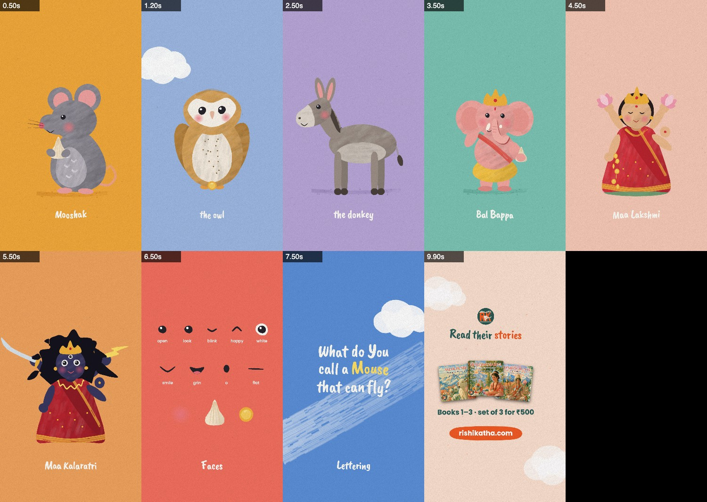

# The Storybook style

A flat picture-book look, modelled on the joke cards the owner shared in Oct 2026 (a flying nun, two chickens): flat
shapes with no outlines and gently uneven edges, soft brush mottling inside them, dry-brush marks (fur, feathers,
whiskers, a white swoosh), dot eyes with a glint, rosy cheeks, bouncy brush lettering and paper grain over all of it.
In motion every edge re-wobbles 10 times a second (a "boil"), the way hand-drawn animation flickers.

**Use it for** riddles, jokes, guessing games, sweet one- or two-character moments, wallpapers, and the kids' picture
books. **Use Painted** for slapstick with many moving limbs, **Cinematic** for epic and dramatic stories.
In viewer or buyer copy never call the art "hand-painted" (owner, Oct 2026).



## What makes it
| ingredient | how | where |
|---|---|---|
| Flat shapes with uneven edges | a closed outline whose radius wobbles at low frequency; a second, slightly offset fill at half alpha makes the edge ragged | `sbBlob`, `sbPoly`, `sbShape` |
| Gouache mottling | ~1 soft curved stroke per 900 px² inside each shape, 3% darker or lighter, clipped | `sbShape` (`tex`, `ang`) |
| A second layer of paint | a gradient shade toward one side (`shade`), a soft round patch (`spot`) | `sbShape` |
| Dry brush | bristles side by side along a curve, each one a continuous line that breaks where it runs dry | `sbDry`, `sbChevrons`, `sbSwoosh` |
| Faces | dot eyes with a white glint (`blink`, `happy` ∩, `look`, `white` ring), blush, tiny mouths | `sbEye`, `sbCheek`, `sbMouth` |
| Lettering | Caveat Brush, each letter its own size, tilt and baseline; some words start with a capital; one word in a contrast colour | `sbSay` |
| Paper | a fixed grain tile multiplied over the whole frame | `LOOK.finish` |
| The boil | every shape's random stream is keyed by its geometry and the boil tick (`SB.boil`, 10 per second) | `sbRng` |

Colour: one flat, saturated wall per beat (marigold, coral, sky blue, lavender, teal, peach), the characters in soft
natural tones on it, white or ink lettering with one word in yellow, ink or orange. Leave lots of empty wall.

## Files
| file | what |
|---|---|
| `src/storybook.js` | the style, on top of `src/cine.js` (load after it): randomness that boils, shapes, lines and dry brush, faces, backgrounds (`sbBg`, `sbCloud`, `sbSwoosh`, `sbGround`), lettering (`sbSay`), the end card (`sbCard`), the paper finish. It turns cine.js's bloom, vignette and film grain off |
| `src/sb_cast.js` | the characters: `sbMouse` (Mooshak, with `sbModak`), `sbOwl` (Maa Lakshmi's barn owl, with `sbCoin`), `sbDonkey` (Maa Kalaratri's), `sbBappa` (Bal Bappa), `sbDevi` (`kind` 'lakshmi' or 'kalaratri'; `sbLotus`, `sbBolt`) |
| `storybook.html`, `src/scenes/sb_sheet.js` | the studio page on main: the cast sheet ([docs/sb_cast.jpg](docs/sb_cast.jpg)) |

`src/storybook.js` needs one hook in cine.js, `LOOK.finish(c, t)`, drawn after `POST` and before the captions.
Frames render in about 2–10 ms.

## Start a reel in this style
1. Branch off `main` as usual. `cp storybook.html studio.html`; swap the inline `PROJECT` for `<script src="src/config.js">`
   and `sb_sheet.js` for your scene. Keep `'100px "Caveat Brush"'` in `PROJECT.fonts`.
2. Write `SHOTS` as in the Cinematic style (`{ a, b, xf, draw(c, u, t) }`, see CINEMATIC_GUIDE.md). Each shot
   paints its wall (`sbBg`), its characters and its lettering. Lettering belongs to the shot (it's part of the picture,
   as on a book page), so don't use `say()` captions.
3. The reel rules in CLAUDE.md all apply: the safe band (y 420–1500, left of x 930), frame 0 finished with the hook
   lettered (pass `age` ≥ 1 or leave it out), ≥2 s a caption, the full card at the end (`sbCard`).

```js
SHOTS.push({ a: 0, b: 4, draw(c, u, t) {
  sbBg(c, '#F2A93B', { speck: [30, 'rgba(201,124,31,.5)'] });
  sbGround(c, 300, 800, 1480, '#D98C27');
  sbMouse(c, 560, 1470, .95, { t, hold: 'modak', hop: u > 2 ? Math.sin((u - 2) * 9) : 0 });
  sbSay(c, 'Guess whose | *ride* I am?', 520, 560, 140, { hi: SB.ink, seed: 4 });
} });
```

## The API
- Characters: `sbX(c, x, y, s, o)` stands the character on (x, y) at scale s (about 700–900 px tall at s 1). Shared
  options: `t` (pass the shot's t: breathing, blinks every ~3 s, idle twitches; `ph` offsets the blink), `blink`,
  `happy`, `look`, `mouth`, `hop` (-1..1 squash/stretch; lift it yourself), `flip`, `rot`, `tilt` (the head), `pal`.
- `sbShape(c, pts, col, o)` / `sbEll(c, x, y, rx, ry, col, o)`: `tex: false` for small parts (hands, feet, pupils),
  `shade: [col, angle, from]`, `spot: [x, y, r, col]`, `alpha`, `seed`. Blob options: `rot`, `wob`, `pear`, `top`.
- `sbLine(c, pts, w, col, o)` a tapered ink line (smiles, whiskers, a trunk); `sbDry(c, pts, w, col, a, bristles, o)`
  (`dry` how fast it runs out, `fade`, `n`).
- `sbSay(c, text, x, y, size, o)`: `|` breaks a line, `*word*` takes `o.hi`; `o.age` springs the words in one by
  one (`stagger`); `col`, `seed` (the same seed always letters a line the same way), `maxW`, `shadow`, `caps`.
- `sbCard(c, u, t, { title, line, price, note, books, deco })`.
- `SB.boil` (0 stops the boil), `SB.paper` (the grain's strength), `SB.ink`, `SB.white`, `SB.font`.

## Building a character
Draw it in its own units, origin between the feet, from a handful of `sbEll` blobs and `sbPoly` shapes, back to front:
far limbs, body, belly patch, near limbs, head (in a `save`/`rotate` about the neck so it can tilt), features last.
Keep it round and simple: a big head, a pear body, tiny feet, two dot eyes, blush. Separate parts by tone, not by
lines (a trunk a shade lighter than the belly it crosses, with a soft offset shadow under it). Use `sbDry` for marks of
texture (chevrons, a mane's fringe), not for solid areas: wide dry strokes over a body look like plaid.

## Books
`tools/book.mjs` renders a book's art from any studio page: `--page=studio.html` on the book's branch. A spread is
3378 × 2668 (`PROJECT.w/h`); draw it in a 1689 × 1334 design space under `c.scale(2, 2)`. Leave each page's text zone
as plain wall (the style is mostly empty wall, so this comes free); faces 12 mm off the fold.

## What worked
- (first reel: `ad/53-books123-guess-ride`, "Guess whose ride I am?")
- **No mid-word capitals.** Random capitals inside words ("tHe DoNkey") read badly; only some words start with one.
